# Roboto Origin Runtime

**[Documentation](https://antonvynohradov.github.io/Roboto-Origin-Runtime/)** · **[Step-by-step setup](https://antonvynohradov.github.io/Roboto-Origin-Runtime/getting-started/)** · **Repository:** `roboto-origin-runtime` · **Docker image:** `ghcr.io/antonvynohradov/roboto-origin-runtime:humble`

Portable, containerised control environment for the
[Roboto Origin](https://github.com/Roboparty/roboto_origin) humanoid robot (RPO), plus a
debug toolkit for bench testing.

The goal is to make the robot computer **replaceable**: the same Docker image runs on a
Raspberry Pi 5, the officially supported RDK X5 / Orange Pi 5 Plus, a Linux laptop or an
x86 mini-PC. Only a thin, scripted host layer (CAN drivers, udev, real-time limits) differs
between machines.

> **Unofficial community project.** Not affiliated with or endorsed by Roboparty.
>
> **Status:** early bench-testing setup. Not yet validated on hardware end-to-end.
> Raspberry Pi 5 is **not** an officially supported controller of `roboparty_deploy`
> (supported: RDK X5, Orange Pi 5 Plus).

---

## What is in this repository

```
roboto-origin-runtime/
├── docker/
│   ├── Dockerfile            ROS 2 Humble + roboparty_deploy, built for arm64 and amd64
│   └── entrypoint.sh         hardware check, per-run log folder, raw CAN capture
├── compose.robot.yml         control stack, runs on the robot computer
├── compose.station.yml       debug station, runs on your laptop (listen + record only)
├── host/
│   ├── setup_host.sh         one-time host preparation (Docker, SocketCAN, udev, RT, Pi 5)
│   └── check_host.sh         health check: CAN buses, RT limits, Pi 5 supply voltage
├── tools/debug/
│   ├── stream_logs.sh        stream dmesg / journal / power data from robot to laptop
│   └── pi_power_monitor.sh   100 ms sampling of Pi 5 input voltage and throttling flags
├── config/                   local overrides (e.g. robot.yaml), mounted read-only
├── docs/                     documentation site sources (Markdown, see below)
├── mkdocs.yml                documentation site configuration
├── .github/workflows/        CI: multi-arch image build to GitHub Container Registry
├── Makefile                  short commands for everything above
└── .env.example              per-machine settings
```

## Architecture in one picture

<p align="center">
  
</p>

Details: [Architecture](https://antonvynohradov.github.io/Roboto-Origin-Runtime/architecture/)

## Quick start

### 1. Robot computer (Linux, 64-bit)

```bash
git clone https://github.com/AntonVynohradov/roboto-origin-runtime.git roboto-origin-runtime
cd roboto-origin-runtime
cp .env.example .env                      # adjust ROS_DOMAIN_ID, ROBOT_HOST ...
sudo ./host/setup_host.sh /path/to/99-auto-up-devs-<board>.rules
sudo reboot
./host/check_host.sh                      # all CAN buses UP, rtprio 98
docker compose -f compose.robot.yml pull  # ready image from GHCR (or: make build)
make shell                                # interactive shell in the container
make start POLICY=default                 # start the control stack
```

### 2. Debug laptop

```bash
git clone https://github.com/AntonVynohradov/roboto-origin-runtime.git roboto-origin-runtime && cd roboto-origin-runtime
cp .env.example .env                      # same ROS_DOMAIN_ID as the robot
make logs                                 # stream robot logs + 5 V monitor to ./logs
make record                               # record all ROS topics to ./logs/<run>/bag
```

Windows users: run the station inside WSL2 (Ubuntu 22.04) with mirrored networking.
See [Debug station](https://antonvynohradov.github.io/Roboto-Origin-Runtime/debug-station/).

## Documentation

**Documentation website:** <https://antonvynohradov.github.io/Roboto-Origin-Runtime/>
– built with [MkDocs Material](https://squidfunk.github.io/mkdocs-material/) from the
Markdown files in `docs/`, including a step-by-step setup guide for people with no Linux
experience.

Edit any `.md` file in `docs/`, push to `main`, and the `docs` workflow rebuilds and
publishes the site. One-time setup: *Settings → Pages → Source: GitHub Actions*.

Preview locally:

```bash
pip install -r requirements-docs.txt
mkdocs serve            # http://127.0.0.1:8000
```

| Document | Content |
|---|---|
| [Getting started](https://antonvynohradov.github.io/Roboto-Origin-Runtime/getting-started/) | Step-by-step setup for beginners |
| [Daily use](https://antonvynohradov.github.io/Roboto-Origin-Runtime/daily-use/) | Power-on order, commands, updating |
| [Architecture](https://antonvynohradov.github.io/Roboto-Origin-Runtime/architecture/) | What runs where, why hardware stays on the host |
| [Host setup](https://antonvynohradov.github.io/Roboto-Origin-Runtime/host-setup/) | Preparing Raspberry Pi OS / Ubuntu / Debian hosts |
| [Debug station](https://antonvynohradov.github.io/Roboto-Origin-Runtime/debug-station/) | Laptop as debug station (Linux and Windows/WSL2) |
| [Power hub V2.1](https://antonvynohradov.github.io/Roboto-Origin-Runtime/power-hub-v2.1/) | Analysis of the RBE PWR HUB V2.1 schematic |
| [Debugging power loss](https://antonvynohradov.github.io/Roboto-Origin-Runtime/debugging-power-loss/) | Procedure for "controller dies when motors are enabled" |
| [Troubleshooting](https://antonvynohradov.github.io/Roboto-Origin-Runtime/troubleshooting/) | Common problems and fixes |

## Safety

- Bench tests only with the robot **hanging on a stand**.
- Keep an **emergency cut-off of the 48 V line** within reach.
- The containers are configured with `restart: "no"`: a crashed control stack must never
  restart by itself while the motors are powered.
- Enable motors with low gains (kp = 0, small kd) until the power issue is understood.

## Licence

Copyright (C) 2026 Roboto Origin Runtime contributors

This project is licensed under the **GNU General Public License v3.0 only**
(`SPDX-License-Identifier: GPL-3.0-only`), the same licence as the upstream
[`roboparty_deploy`](https://github.com/Roboparty/roboparty_deploy) control software and the
[`roboto_origin`](https://github.com/Roboparty/roboto_origin) aggregation repository.
See [LICENSE](LICENSE) for the full text.

This program is distributed in the hope that it will be useful, but WITHOUT ANY WARRANTY;
without even the implied warranty of MERCHANTABILITY or FITNESS FOR A PARTICULAR PURPOSE.
Operating a powered robot is at your own risk.

## Credits

- Robot design, firmware and control software: [Roboparty](https://github.com/Roboparty).
  `roboparty_deploy` is **downloaded at image build time** and keeps its own licence and
  third-party notices; it is not redistributed in this repository.
- Images built from this repository contain `roboparty_deploy` and its dependencies. If you
  publish such an image (e.g. on GHCR), the GPL obligations of those components apply to it
  as well: point to their source repositories and the exact `DEPLOY_REF` used.
- This repository is an unofficial community project, not affiliated with or endorsed by
  Roboparty.
