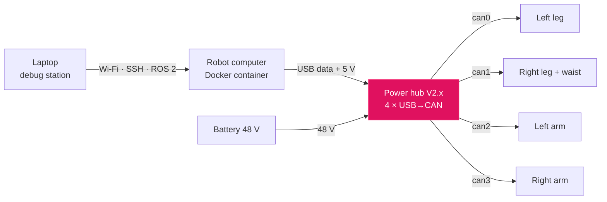

---
hide:
  - navigation
---

# Roboto Origin Runtime

One Docker image that turns a Raspberry Pi 5, an RDK X5, a Linux laptop or a mini-PC into
the control computer of the [Roboto Origin](https://github.com/Roboparty/roboto_origin)
humanoid robot, with a debug station on your own laptop.

<b>ROS 2 Humble</b>control stack

<b>arm64 + amd64</b>one image

<b>4 × CAN</b>1 Mbit/s, 23 motors

<b>≈ 1.5 h</b>first setup

[Start the setup](getting-started.md){ .md-button .md-button--primary }
[Source on GitHub](https://github.com/AntonVynohradov/roboto-origin-runtime){ .md-button }

!!! warning "Unofficial project, early stage"
    Roboto Origin Runtime is a community project, not affiliated with or endorsed by
    Roboparty. It is a bench-testing setup and has not yet been validated end-to-end on
    hardware. Raspberry Pi 5 is not an officially supported controller of
    `roboparty_deploy` (supported: RDK X5, Orange Pi 5 Plus).

## How it fits together

- The **robot computer** runs the control software (`roboparty_deploy`) inside a container.
  Kernel-level parts (CAN drivers, USB port mapping, real-time limits) are set up once on
  the host by a script.
- The **laptop** never drives motors. It records logs, the computer's supply voltage and all
  ROS 2 topics, so data survives even if the robot computer loses power.

## Where to go next

| I want to… | Read |
|---|---|
| Set everything up for the first time | [Step-by-step setup](getting-started.md) |
| Start and stop the robot | [Daily use](daily-use.md) |
| Record logs on my laptop (Windows, macOS, Linux) | [Debug laptop](debug-station.md) |
| Understand what runs where | [Architecture](architecture.md) |
| Fix a problem | [Troubleshooting](troubleshooting.md) |
| Find out why the controller turns off when motors are enabled | [Debugging power loss](debugging-power-loss.md) |

## Licence

GPL-3.0-only, the same licence as the upstream Roboparty projects. The Roboparty control
code is downloaded when the image is built and keeps its own licence and notices.
